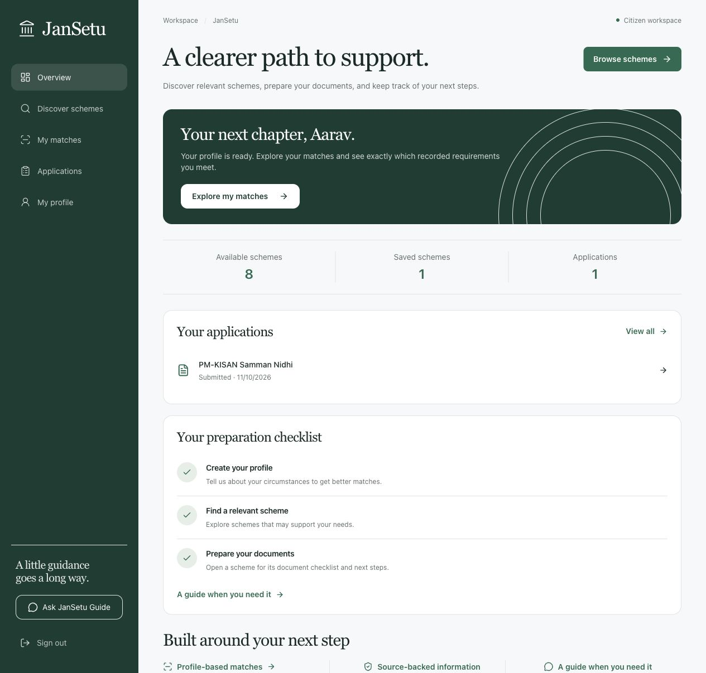
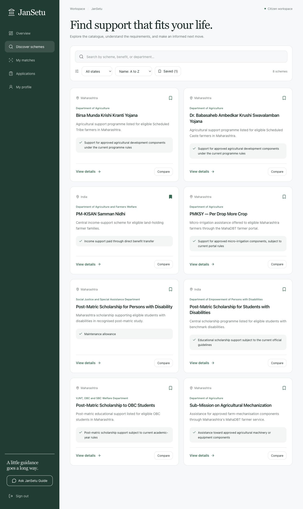
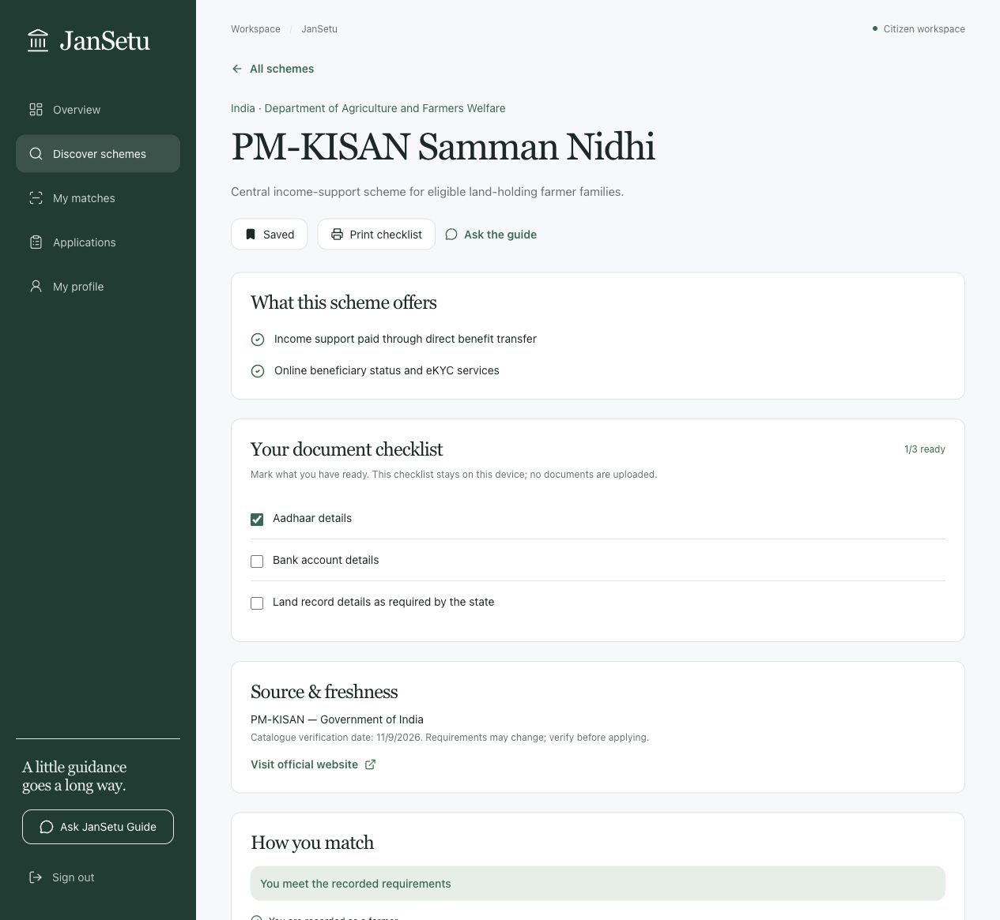
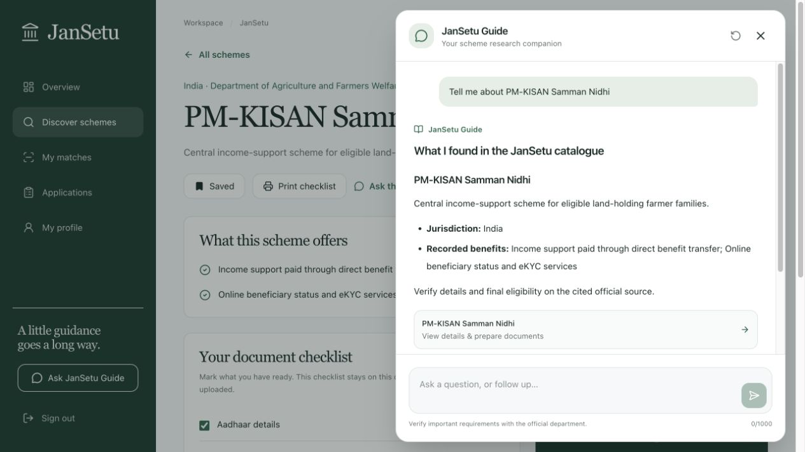
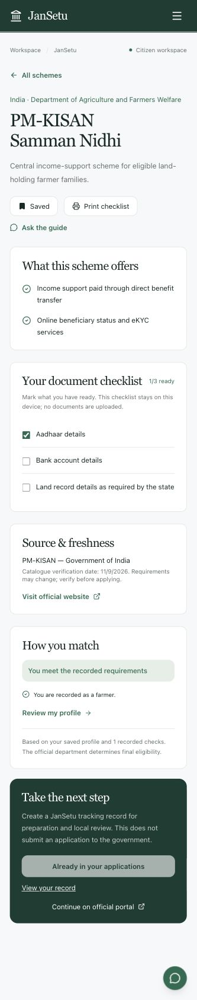
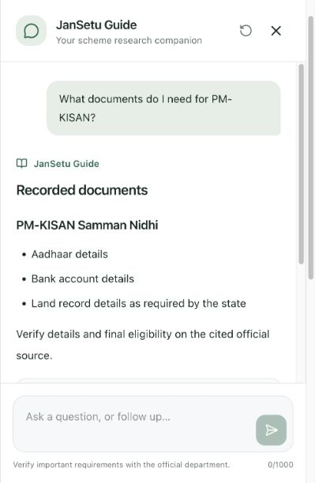

# JanSetu

JanSetu is a source-backed welfare discovery and application-tracking platform for Indian citizens. It combines deterministic eligibility checks with an optional AI explanation layer, an editorial scheme catalogue, and an audited administrator workflow.

## What is included

- Responsive forest-green interface with accessible citizen and administrator workspaces
- Versioned PostgreSQL schema managed by Flyway
- Source-linked starter catalogue covering central and Maharashtra services
- Explainable, deterministic eligibility outcomes
- Scheme discovery, recommendations, application tracking, and admin status review
- Local grounded JanSetu Guide with citations and structured result cards
- Optional Gemini-compatible provider, disabled by default to avoid spend and unnecessary data sharing

## App screenshots

Captured from the running production build with a synthetic demo account. These are real responsive app screens, not design mockups. Select an image to view it at full size.

<table>
<tr>
<td width="50%" valign="top" align="center">
<h3>Citizen overview</h3>
<a href="docs/screenshots/citizen-overview.jpg"></a>
<p>Live workspace counts and a clear next step.</p>
</td>
<td width="50%" valign="top" align="center">
<h3>Scheme discovery</h3>
<a href="docs/screenshots/scheme-discovery.jpg"></a>
<p>Search, jurisdiction filters, saves, and comparisons.</p>
</td>
</tr>
<tr>
<td width="50%" valign="top" align="center">
<h3>Eligibility &amp; preparation</h3>
<a href="docs/screenshots/scheme-detail.jpg"></a>
<p>Explainable checks, document readiness, and official sources.</p>
</td>
<td width="50%" valign="top" align="center">
<h3>JanSetu Guide</h3>
<a href="docs/screenshots/jansetu-guide-desktop.jpg"></a>
<p>A real catalogue-grounded answer without an external model.</p>
</td>
</tr>
</table>

<details>
<summary>Mobile views: scheme preparation and guide</summary>
<br />


</details>

## Local development

Requirements: Java 21, Node.js 20+, Docker, and Docker Compose.

1. Start PostgreSQL:

   ```bash
   docker compose up -d postgres
   ```

2. Start the backend:

   ```bash
   cd backend
   DATABASE_USERNAME=jansetu \
   DATABASE_PASSWORD=jansetu \
   JWT_SECRET_KEY=replace-with-a-long-random-secret-at-least-32-characters \
   ./mvnw spring-boot:run
   ```

3. Start the frontend in a second terminal:

   ```bash
   cd frontend
   npm install
   npm run dev
   ```

Open `http://localhost:3000`. The API and Swagger UI run at `http://localhost:8080` and `http://localhost:8080/swagger-ui.html`.

## Administrator access

Citizen registration is strictly limited to citizen accounts to prevent privilege escalation. Administrator bootstrap is disabled by default. An operator may explicitly provision the initial account by setting:

- **Email:** `admin@jansetu.gov.in` (customizable via `JANSETU_ADMIN_EMAIL`)
- **Password:** `JANSETU_ADMIN_PASSWORD`, a unique password of at least 12 characters; there is no default password.

Log in with the operator-configured credentials to access the `/admin` desk for scheme drafting, publishing, archiving, and application review.

## AI provider usage

JanSetu Guide uses local catalogue retrieval and deterministic responses by default, so normal development consumes no model credits. To explicitly enable the remote provider, set both `GEMINI_API_KEY` and `JANSETU_AI_PROVIDER_ENABLED=true` before starting the backend. Never commit provider keys.

## Verification

```bash
cd backend && ./mvnw test
cd frontend && npm run lint
cd frontend && npx tsc --noEmit
```

Scheme information is a discovery aid, not a final government eligibility decision. The catalogue retains official source links and verification dates so important details can be checked before applying.

## Citizen workspace

Save schemes on this device, compare up to three schemes, check recorded eligibility, and prepare a printable document checklist. Tracking records and their review history live in PostgreSQL. A tracking record does not submit a government application: official portals are linked separately.

The guide keeps bounded scheme context for follow-up questions, returns source cards, and explains deterministic eligibility reasons. It works without an external model. Missing profiles produce actionable guidance rather than errors. Search, status filters, explicit loading/error states, and account-scoped query cleanup support everyday use.

## Engineering and limitations

See [engineering notes](docs/ENGINEERING.md) for data boundaries, verification, and deployment requirements. Run `npm run build` in the frontend before deployment. Java 21 is the intended build runtime; local verification on this machine also uses JDK 22. JDK 25 is incompatible with the current Lombok version.

Catalogue dates reflect recorded seed metadata, not automatic real-time verification. Government rules can change. External provider integration requires operator configuration and has not been live-tested here. This repository does not integrate government submission APIs.
